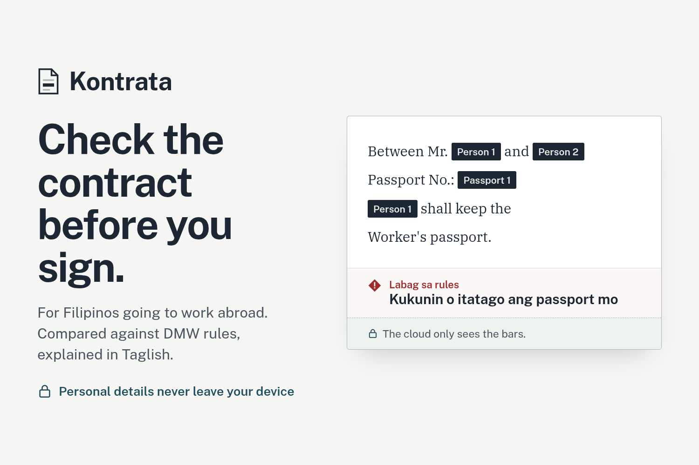

# Kontrata

**Check your overseas job contract before you sign, without giving your personal details to an AI.**

Kontrata checks a contract or a recruiter's post against Philippine Department of Migrant Workers (DMW) rules and
explains it in everyday Taglish, Cebuano or English. It is built on **Firebase AI Logic hybrid inference**: names,
passport and phone numbers are found and covered **on the device** (Gemini Nano); only the anonymous text reaches
Gemini in the cloud.

**Try it:** https://kontrata-hybrid.web.app · Entry for #BuildHybridAI 2026



## How the "Airlock" works

| Step | How | Where |
|---|---|---|
| Read a photo of the contract | Gemini Nano multimodal (`ONLY_ON_DEVICE`) → else Tesseract (web) / ML Kit (Android) | Device |
| Find names and addresses | Gemini Nano (`ONLY_ON_DEVICE`) | Device |
| Phones, passports, IDs, IBANs, form fields | Deterministic detectors | Device |
| Leak gate + model-free name scan → verdict | Fail-closed: `safe` only if every layer agrees; otherwise the user reviews | Device |
| DMW rule checks with verbatim citations | Deterministic rules engine | Device (offline) |
| Explanation + questions for the agency | Gemini `ONLY_IN_CLOUD`, redacted text only; names restored on the device | Cloud |

## Repository

| Path | What |
|---|---|
| `packages/core` | The shared engine: redaction, leak gate, verdict, DMW rules, cloud prompt/validation, interface copy. **144 tests** (`npm test`) |
| `apps/web` | Web app (React + Vite) on Firebase Hosting. Developer lab at `/#lab` |
| `apps/extension` | Chrome MV3 extension: right-click → "I-check sa Kontrata". Offline, no network code. [Download v0.1.0](https://github.com/gauciv/kontrata/releases/tag/v0.1.0) |
| `apps/android` | Kotlin + Jetpack Compose app. Runs the same engine in Jetpack JavaScriptSandbox. See its README |
| `docs/sources` | The DMW contracts, laws and issuances every rule cites (`SOURCES.csv`) |
| `docs/THREAT-MODEL.md` · `docs/BENCHMARKS.md` · `docs/DESIGN.md` | Security model, on-device benchmarks, design notes |

## Run it

```bash
npm install
npm test                      # 144 engine tests
npm run dev                   # web app on localhost (App Check debug token required for cloud calls)
npm run build:ext             # Chrome extension → load unpacked: apps/extension/dist
npm -w packages/core run build:bridge && (cd apps/android && ./gradlew assembleDebug)   # Android
```

On-device AI in the web app needs desktop Chrome ≥ 139 with `chrome://flags/#prompt-api-for-gemini-nano-multimodal-input`
enabled. Without it, the app still covers personal details with its deterministic layers and asks the user to review.

## Honest limits

- On-device Gemini Nano on **Android** is implemented but not verified: no supported phone was available, and the
  emulator has no Nano model. The web on-device path was verified on real hardware (`docs/BENCHMARKS.md`).
- Recruiter posts in `docs/sources/real-samples/` are **synthetic composites** of DMW-documented red flags; worker
  quotes come from Amnesty International's published report, not interviews.
- Not legal advice. For an official answer, contact the DMW (hotline 1348).

## License

Apache 2.0. See [LICENSE](LICENSE). Fonts: Public Sans and IBM Plex Serif (SIL Open Font License 1.1).
